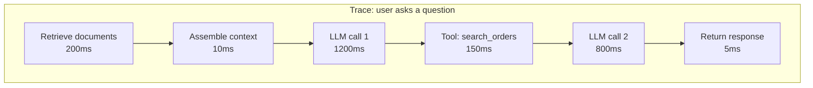

# Observability for AI Systems

In traditional systems, observability is logs, metrics, and traces. In AI systems, you need all three plus a way to reconstruct what the model saw and produced when something goes wrong. Without that, debugging is guesswork.

The question you want to be able to answer: "What did the model see when it produced that output?" The catch is that the answer is usually made of user data. Prompts, responses, tool arguments, and tool results can hold personal information, secrets, and proprietary context. So answering that question for every call, forever, is not the default you want.

## What to instrument

Split what you record into two tiers.

**On by default, for every call:**

- **Metadata** — model name and version, temperature, token counts (input and output), finish reason (completed, max tokens, stop sequence), latency, errors.

- **Structure** — trace and span IDs, which step of an agent loop this is, which prompt template version was used, which tools were offered, which tool was called, how long it took, and whether it errored.

**Off by default, enabled deliberately:**

- **The full prompt** — system prompt + assembled context + user input. Not the template — the actual text the model received.

- **The full response** — raw output, including any reasoning or tool calls.

- **Tool arguments and results** — what the model passed in and what came back.

OpenTelemetry's GenAI conventions draw the same line. Prompt and response messages are opt-in attributes, flagged as likely to contain sensitive data, and instrumentations capture them only when you turn content capture on ([GenAI events conventions](https://github.com/open-telemetry/semantic-conventions-genai/blob/main/docs/gen-ai/gen-ai-events.md); [OpenTelemetry GenAI observability guide](https://opentelemetry.io/blog/2026/genai-observability/), both checked 2026-10-12).

When you do need content, turn it on narrowly: for a specific incident, a specific tenant who agreed to it, a debug environment, or an approved sample for evaluation. Decide up front who can switch it on, what gets redacted, who can read it, and how long it lives (more on that below). Those answers come from your privacy and security policy, not from this chapter.

## Tracing AI applications

A trace follows a single user request through your system. For a simple LLM call, the trace has one span. For an agent, it might have 10+ spans — one per LLM call, one per tool call, one per decision point.

OpenTelemetry (the standard observability framework) has semantic conventions for LLM calls — standard attribute names for model, tokens, latency, etc. Using these means your traces are compatible with multiple observability backends. A trace like the one above is still useful with content capture off: you can see which step was slow, which tool failed, and where the tokens went.

## Metrics that matter

**Latency:**

- Time to first token (TTFT) — what the user waits before seeing anything

- Total response time — end to end

- Track p50, p95, p99 — tail latency is what kills user experience

**Quality:**

- Eval scores on a sampled subset of production calls (run your eval harness continuously)

- User feedback rates (thumbs up/down, corrections, escalations)

- Refusal rate — how often the model declines to answer

- Parse failure rate — how often the output doesn't match expected format

**Cost:**

- Tokens in and out per request

- Dollar cost per request

- Cost per user, per feature, per team

**Errors:**

- API errors (timeouts, rate limits, 500s from the provider)

- Tool call failures

- Agent loop timeouts (hit max steps)

## Online evaluation (eval in production)

Your offline eval harness tests against a fixed set of cases. Online evaluation tests against real traffic.

Approaches:

- **Sample and score.** Pick 1-5% of production calls. Run your LLM-as-judge scorer on them. Track the score over time. If it drops, something changed.

- **Human review queue.** Route a small sample to human reviewers. More expensive but catches things automated scoring misses.

- **User signals.** Track thumbs up/down, "was this helpful?" responses, follow-up questions (which often indicate the first answer wasn't good enough), escalations to humans.

The goal: detect quality regressions in production before users complain. A dashboard showing "quality score over time" with an alert threshold is the minimum.

## Drift detection

Quality can degrade without anyone changing anything:

- The model provider pushes an update

- User behavior shifts (new topics, new patterns)

- Retrieved documents change (knowledge base updated)

- External APIs change their responses

Drift detection compares current quality metrics against a baseline. When the difference exceeds a threshold, alert. This is the AI equivalent of anomaly detection on your traditional metrics.

## The tools

**Specialized AI observability:**

- **Langfuse** — open-source, widely used, good tracing + eval integration

- **Braintrust** — hosted, strong eval focus, good for managing test sets

- **Helicone** — focused on cost tracking and request logging

- **LangSmith** — LangChain's companion tool, tightly integrated with that ecosystem

- **Arize Phoenix** — open-source, strong on traces and evals together

**General observability (works too):**

- OpenTelemetry + your existing stack (Datadog, Grafana, etc.)

- Structured logs to your existing log aggregator

- Custom dashboards in whatever you already use

You don't need a specialized tool to start. Structured logging of every LLM call's metadata into your existing log system gets you most of the value, with content capture behind a flag you turn on when you need it. Whatever tool you pick, check whether it records prompts and responses by default and how to turn that off. Specialized tools add better UX for browsing traces, running evals, and comparing prompt versions.

## Privacy and cost of logging

Logging full prompts means logging user data. That's why content capture is opt-in, and turning it on creates obligations:

- **PII, secrets, and proprietary context in logs.** User messages, retrieved documents, and tool outputs often contain personal information, credentials, or internal material. Redact or mask sensitive fields before logging, and treat redaction as best effort, not a guarantee.

- **Encryption at rest.** Logs containing user data should be encrypted.

- **Retention policies.** Don't keep content logs forever. Keep them shorter than your metadata, for a period your privacy policy approves, and auto-delete.

- **Access controls.** Not everyone should be able to read full prompt logs.

- **Cost.** Full-context logging at scale is expensive (storage + processing). Another reason not to do it for every call. Capture content for the incidents and eval samples you actually need, rather than routinely storing successful calls.

## Things to watch for

**Logging the prompt template, not the actual prompt.** Your template says `{system_prompt} + {context} + {user_input}`. Your logs show the template variables. When you've turned content capture on to debug something, you need the fully assembled text the model actually received. Capture that.

**No correlation IDs.** A multi-step agent makes 5 LLM calls. Without a shared request ID linking them, you can't reconstruct the full trajectory. Use correlation IDs from the start.

**Dashboards without alerts.** A dashboard you check once a week is decorative. Set alert thresholds on key metrics (latency p99, error rate, quality score) so you know when things break.

**Prompt caching makes latency metrics misleading.** A cached request is fast; an uncached one is slow. If you don't account for cache state in your metrics, your latency numbers are noisy and hard to interpret.

**"The model did X" is hard to reproduce without the content.** If someone reports a bad output and you can't find the exact prompt that produced it, debugging is much harder. Plan for this before the incident: know how to turn content capture on for that user, tenant, or flow, so the next occurrence is recorded. Turning it on for everything just in case trades a debugging problem for a data-exposure one.

**Content capture left on by accident.** A debug flag gets set in production and never turned off. Make it expire, alert when it's on, and review who enabled it.

## Where things stand

AI observability tooling is maturing fast. The patterns are clear (trace every call, capture metadata by default, capture content deliberately, run continuous eval, alert on drift). The tools are getting better. The main gap is that most teams under-invest in observability early and then struggle to debug production issues.

Start simple: log every LLM call with model and metadata, and add an opt-in switch for content. Add tracing when you have agents. Add continuous eval when you have enough traffic to sample. Add drift detection when you've been running long enough to have a baseline.

## Go deeper

- [Workshop W6 — Observability Setup](../05-workshops/W6-observability-setup.md). Instrument an agent end-to-end.

- [Langfuse documentation](https://langfuse.com/docs) — open-source, good starting point

- [OpenTelemetry GenAI semantic conventions](https://github.com/open-telemetry/semantic-conventions-genai/blob/main/docs/registry/attributes/gen-ai.md) — the emerging standard's attribute registry, including which content fields are opt-in (checked 2026-10-12)

- [Braintrust blog](https://www.braintrust.dev/blog) — production observability patterns
