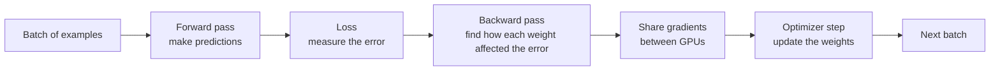

# Distributed Training Systems

Training a model is a distributed systems problem with unusually expensive workers.

Every GPU repeats the same training step. At scale, the GPUs must exchange data during that step. One slow GPU, link, or data loader can hold up the whole job.

## One training step, in plain English

A model contains billions of **weights**: learned numbers that control how an input is transformed into an output. Training adjusts those weights a little at a time.

Each step processes a **batch**, which is a small group of training examples:



**Forward pass.** The model uses its current weights to make a prediction for the batch. For a language model, that prediction is a set of scores for the possible next token. It also saves some of its intermediate calculations because they will be needed to learn from the error.

**Loss.** The training code compares the prediction with the expected answer and produces one number that represents how wrong the model was. Lower is better for that batch, but one low number does not mean the model is good overall.

**Backward pass.** The system asks, for every weight: "If this number changed slightly, would the error become larger or smaller, and by how much?" Consider a simplified chain:

```text
weight → layer result → prediction → loss
```

It starts at the end and checks each link in reverse: how a small change in the prediction affects the loss, how a small change in the layer result affects the prediction, and finally how a small change in the weight affects the layer result. For this simple chain, it multiplies the effect measured at each link. The result says how a small change in the weight would change the loss. That result is the weight's **gradient**. Frameworks such as PyTorch do this automatically for every weight; this is **automatic differentiation**.

### Worked example: one weight

Use a deliberately small model:

```text
prediction = weight × input
loss = (prediction - expected answer)²
```

Suppose the input is `2`, the expected answer is `10`, and the current weight is `3`.

The forward pass calculates:

```text
prediction = 3 × 2 = 6
loss = (6 - 10)² = 16
```

To see what the gradient means, increase the weight by only `0.001`:

```text
new prediction = 3.001 × 2 = 6.002
new loss = (6.002 - 10)² = 15.984004

change in loss / change in weight
  = (15.984004 - 16) / 0.001
  ≈ -16
```

This small test shows that increasing the weight slightly decreases the loss. The gradient is about `-16`: around this point, a `0.001` increase in the weight produces roughly a `0.016` decrease in the loss.

Trying a small change for each of billions of weights would be far too slow. The backward pass gets the same result from the operations already used by the model:

```text
loss = (prediction - expected answer)²
local rate of change = 2 × (6 - 10) = -8

prediction = weight × input
local rate of change = input = 2

gradient for the weight = -8 × 2 = -16
```

The first `-8` describes how the loss changes when the prediction changes. The `2` describes how the prediction changes when the weight changes. Multiplying them connects the two links and gives the effect of the weight on the loss.

The negative gradient means increasing the weight should reduce the loss. With a learning rate of `0.01`, a basic optimizer update is:

```text
new weight = 3 - (0.01 × -16) = 3.16
```

The next forward pass produces a prediction closer to `10`. A real neural network repeats this calculation through many connected operations for billions of weights. Automatic differentiation handles that bookkeeping.

**Optimizer step.** The gradients provide directions, but they do not change the model themselves. An optimizer such as AdamW uses them to nudge each weight a small distance in the direction expected to reduce the error. The gradients are then cleared and the next batch starts.

Training repeats this cycle many times. The useful behavior comes from millions of small weight updates, not one dramatic change.

In data-parallel training, each GPU processes a different local batch. The GPUs combine their gradients before the optimizer step so their copies of the model stay in sync.

## What training needs

| Resource | What uses it | Common failure |
|---|---|---|
| GPU compute | Matrix multiplication in forward and backward passes | Kernels, batch size, or precision leave the GPU underused |
| GPU memory | Weights, gradients, optimizer state, activations | The model or batch does not fit |
| Network | Gradients, parameters, activations, or tokens moving between GPUs | Communication takes over the step time |
| Storage | Dataset reads and checkpoint writes | GPUs wait for data or checkpoint I/O |
| Scheduler | Allocating all workers together | Part of a job starts and holds scarce GPUs |

This is why a healthy training platform is more than a set of GPU virtual machines.

## The memory problem

Inference mainly stores model weights and a working cache. Full training stores more:

- Model weights
- Gradients
- Optimizer state
- Activations saved for the backward pass

For mixed-precision training with Adam, a common simplified estimate is:

```text
2 bytes  low-precision weight
2 bytes  gradient
4 bytes  full-precision copy of the weight
4 bytes  Adam running average
4 bytes  Adam running variance
--------
16 bytes per parameter, before activations
```

A 70-billion-parameter model is therefore roughly:

```text
70 billion × 16 bytes = 1.12 TB
```

That estimate is not a capacity plan. Framework choices change it. It is a quick way to prove that the job needs sharding.

Activation checkpointing reduces memory by discarding some activations and recomputing them later. It trades extra compute for lower memory use.

## The parallelism toolbox

There is no single "distributed training" switch. A method may divide the input examples, the model's calculations, or the model state stored in memory.

| Method | What is divided across GPUs | What each GPU does | Why GPUs communicate |
|---|---|---|---|
| Data parallelism | One global batch into one local batch per GPU | Holds the full model and trains on its local batch | Average the gradients produced by every GPU |
| FSDP / ZeRO | Ownership of model state: parameters, gradients, and optimizer state, depending on the method or ZeRO stage | Temporarily gathers the parameters needed for a layer, computes with them, then keeps only its assigned shards | Gather parameters and combine and repartition gradients |
| Tensor parallelism | The matrix calculations inside each layer | Computes one slice of the same layer | Combine partial results during every layer |
| Pipeline parallelism | Groups of complete layers | Runs one stage of the model | Pass activations forward and their gradients backward between stages |
| Expert parallelism | The experts in a mixture-of-experts layer | Hosts some experts and processes tokens routed to them | Send tokens to the GPUs that host their chosen experts |

### What happens to the batch and gradients?

The **dataset** contains all training examples. Training processes it over many steps.

At each step, the system selects one **global batch** from the dataset. Data parallelism divides that global batch into **local batches**, one for each GPU:

```text
dataset: all training examples
  → training step: global batch of 1,024 examples
      → GPU 0: local batch of 256 examples
      → GPU 1: local batch of 256 examples
      → GPU 2: local batch of 256 examples
      → GPU 3: local batch of 256 examples
  → next training step: next global batch
```

So yes: each GPU processes one local batch during the step. Together, those four local batches form the global batch used for one model update.

Each GPU has a full copy of the model. It runs the forward and backward passes on its local batch and produces a complete gradient for every weight. The four GPUs then average their gradients. Each model copy applies the same averaged update, so the copies remain identical.

For one simplified weight, two GPUs might produce:

```text
GPU 0
  local examples: A and B
  local gradient: -12

GPU 1
  local examples: C and D
  local gradient: -20

all-reduce average: (-12 - 20) / 2 = -16
```

Both GPUs give `-16` to their optimizers and make the same weight update. The training collective shares the gradients, not examples A, B, C, and D. With a real model, each local gradient is a large tensor containing one value for every weight rather than a single number.

FSDP and some ZeRO stages change where those gradients are kept. As blocks of gradients are produced during the backward pass, a **reduce-scatter** operation averages each block across the GPUs and leaves each GPU responsible for only one part of the result. The gradients were not divided before training; their storage is partitioned as they are calculated.

**FSDP** is Fully Sharded Data Parallel. It gives each worker ownership of only part of the model state, then gathers each layer when needed.

**Tensor parallelism** is much more sensitive to latency because GPUs communicate within every layer. Keep it on the fastest available interconnect. On a conventional eight-GPU server, that usually means inside the server.

Large runs combine these methods. For example: tensor parallel inside a server, pipeline parallel across a few servers, then sharded data parallel across the rest.

## Collectives are the hidden API

Distributed frameworks call collective communication operations:

- **All-reduce:** combine gradients and return the result to every GPU.
- **All-gather:** collect shards so every worker has the full value.
- **Reduce-scatter:** combine values, then give each worker one shard.
- **All-to-all:** every worker sends different data to every other worker.

NCCL, the NVIDIA Collective Communications Library, maps those operations onto NVLink, PCIe, InfiniBand, RoCE, or sockets.

When a training job is slow, "the network is fine" is not enough. The useful question is whether the collective used by this job reaches the expected bandwidth at this node count and message size.

## Performance: useful work, not peak FLOPS

**Model FLOPs Utilization (MFU)** estimates how much of the GPU's theoretical math rate becomes useful model work:

```text
MFU = achieved model FLOP/s / peak hardware FLOP/s
```

Peak numbers are not a promise. Communication, data loading, recomputation, pipeline bubbles, and failures all reduce useful throughput.

Track **goodput** too: the share of wall-clock time that produces useful training progress. A job can have decent MFU while it is running and still have poor goodput because it restarts often.

## Training time estimate

A **dense transformer** uses the same complete set of layers for every token. Each token passes through every attention and feed-forward layer, so nearly all the model's parameters take part in its computation.

This differs from a **mixture-of-experts**, or MoE, transformer. An MoE model has many alternative expert blocks and routes each token through only a small selection of them. It may therefore have many total parameters but use only a fraction for each token.

A common estimate for training a dense transformer is:

```text
training FLOPs ≈ 6 × parameters × training tokens

time ≈ training FLOPs /
       (GPU count × peak FLOP/s per GPU × expected MFU)
```

For example, assume:

- 1 billion parameters
- 100 billion training tokens
- 100 GPUs rated at 100 teraFLOP/s each
- 50% expected MFU

```text
training work
  = 6 × 1 billion × 100 billion
  = 600,000,000,000,000,000,000 FLOPs

effective cluster performance
  = 100 GPUs × 100,000,000,000,000 FLOP/s × 0.50
  = 5,000,000,000,000,000 FLOP/s

estimated time
  = training work / effective cluster performance
  = 120,000 seconds
  ≈ 33 hours
```

Treat the result as a range. MFU is an assumption until the real code, data path, and parallelism run on the target cluster.

For an MoE model, total parameter count is not enough for this estimate because not every expert processes every token. Use the number of active parameters and account for the cost of routing and moving tokens between experts.

## Failure is part of the design

At hundreds or thousands of GPUs, hardware and network failures are normal.

A long-running job needs:

- Sharded checkpoints that do not funnel through one process
- Asynchronous writes where the framework supports them
- Automatic node drain and replacement
- A restart or requeue path
- Spare capacity
- Health checks that catch slow nodes, not only dead nodes

Checkpoint frequency is a trade-off. Write too often and the job spends time on storage. Write too rarely and each failure destroys more work.

## A useful debug order

When scaling efficiency is poor:

1. Prove single-GPU compute.
2. Prove one server across its GPU interconnect.
3. Run collective benchmarks across servers.
4. Check placement and topology.
5. Replace the real dataset with synthetic data.
6. Compare per-rank step times to find stragglers.
7. Profile compute and communication overlap.

This order separates application, fabric, storage, and hardware problems.

## Things to watch for

**Adding GPUs before fixing the bottleneck.** More workers can make communication or storage pressure worse.

**Using average step time.** One slow rank controls a synchronous job. Look at the distribution.

**Assuming FSDP removes the network problem.** It saves memory by communicating more.

**Checkpointing to one shared file.** It creates a bottleneck and a large failure domain.

## Go deeper

- [PyTorch FSDP documentation](https://pytorch.org/docs/stable/fsdp.html)
- [ZeRO paper](https://arxiv.org/abs/1910.02054)
- [Megatron-LM parallelism paper](https://arxiv.org/abs/2104.04473)
- [NCCL documentation](https://docs.nvidia.com/deeplearning/nccl/user-guide/docs/)
- [AI infrastructure video guide](../reference/ai-infrastructure-videos.md#distributed-training)

---

[← Previous: ML Algorithms for Architects](21-ml-algorithms-for-architects.md) · [Next: Self-Hosted Inference →](23-self-hosted-inference.md)
