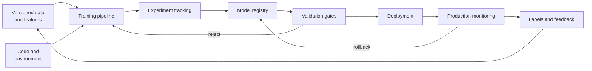

# The MLOps Lifecycle

MLOps is the engineering system around a machine-learning model.

Training code is only one part. The data, environment, experiment, model artifact, validation results, deployment, and production feedback must also be repeatable and governed.

## Why DevOps is not quite enough

Normal software behavior mostly follows from code and configuration.

ML behavior also follows from:

- Training data
- Feature definitions
- Labels
- Algorithm and hyperparameters
- Random seeds
- Framework and hardware
- Model artifact
- Serving-time data

The code can stay unchanged while the model changes because the data changed. MLOps makes those inputs visible.

## The lifecycle



This is a loop, not a one-way release pipeline.

## The artifacts to track

| Artifact | What to record |
|---|---|
| Source code | Commit, branch, training entry point |
| Data | Snapshot, table version, object manifest, or content hash |
| Features | Definition, transformation code, schema, owner |
| Environment | Container image, packages, driver, framework |
| Training run | Parameters, metrics, logs, hardware, duration |
| Model | Weights, format, signature, dependencies |
| Evaluation | Dataset version, metrics, thresholds, approval |
| Deployment | Model version, endpoint, configuration, traffic |
| Monitoring | Inputs, predictions, labels, drift, service metrics |

A model file without this context is hard to reproduce and risky to deploy.

## Data and feature preparation

Most ML failures begin before training.

The pipeline should validate:

- Required columns and types
- Missing values
- Allowed ranges
- Label availability
- Duplicate or corrupt examples
- Time boundaries
- Sensitive-data rules

For conventional ML, a **feature store** can define reusable features and serve the same values to training and online inference. It helps prevent **training-serving skew**, where production computes a feature differently from training.

Do not add a feature store for one batch model with simple inputs. It is infrastructure with its own consistency and ownership problems.

## Experiment tracking

Training produces many runs with different data, code, and settings.

An experiment tracker such as MLflow records:

- Parameters
- Metrics
- Artifacts
- Source version
- Environment
- Parent and child runs

The tracker should answer: "Why did this model become the candidate?"

It should not become an uncurated attic. Define naming, ownership, retention, and the metrics required for comparison.

## Reproducible training pipelines

A pipeline turns notebook steps into versioned components:

1. Validate data.
2. Build features.
3. Train.
4. Evaluate.
5. Register the model.
6. Produce a report.

Kubeflow Pipelines represents steps as containerized components and runs them on Kubernetes. Other options include Argo Workflows, Airflow, Metaflow, and cloud-managed ML pipelines.

Choose from the team's platform and workload. Airflow is useful for general data orchestration. Kubeflow fits containerized ML workflows on Kubernetes. A Python script in CI may be enough for a small system.

The orchestrator should manage dependencies and retries. Training code should remain runnable outside the orchestrator for debugging.

## Model registry and promotion

A model registry stores versions and the metadata needed to deploy them.

A registered model moves through decisions such as:

```text
new run → candidate → validated → champion → retired
```

These are labels, not separate copies of the model.

Current MLflow uses model aliases and tags for this workflow. Fixed model stages are deprecated. An alias such as `candidate` or `champion` can be reassigned to another version without changing application code.

Promotion should require evidence:

- Task metric meets its threshold
- No important segment regressed
- Input and output schema is compatible
- Latency and resource use are acceptable
- Security and governance checks pass
- An owner approves high-risk changes

## CI, CD, and CT

MLOps adds **continuous training (CT)** to continuous integration and delivery.

**CI** tests code, components, data contracts, and a small training run.

**CD** packages and promotes a validated model through environments.

**CT** retrains when a schedule, data arrival, drift signal, or performance threshold says it is needed.

Continuous training should not mean continuous deployment. A new model can be worse even when the pipeline succeeds.

## Deployment patterns

**Batch deployment** writes predictions to storage or a database. It favors throughput and restartable work.

**Online deployment** serves predictions through an API. It needs latency, availability, scaling, and feature-freshness controls.

Safe release patterns include:

- Shadow: new model receives copied traffic but serves no answers
- Canary: new model serves a small share
- A/B test: models serve different user groups for a product experiment
- Blue/green: two complete versions with a controlled switch

Rollback should be a normal alias or routing change, not a rebuild.

## Monitoring four different things

### Service health

- Request latency and error rate
- Throughput and queue depth
- CPU, GPU, memory, and network
- Model-load and cold-start time

### Data quality

- Missing or invalid inputs
- Schema changes
- Feature freshness
- Range and category changes

### Model behavior

- Prediction distribution
- Confidence and calibration
- Data drift
- Concept drift
- Segment-level performance

**Data drift** means the input distribution changed. It does not prove quality got worse.

**Concept drift** means the relationship between inputs and correct answers changed. You need fresh labels to detect it reliably.

### Business outcome

- Fraud loss
- Conversion
- Defect escape rate
- Resolution time
- Human override rate

A healthy endpoint serving a useless model is still a production failure.

## Labels and delayed truth

Many models do not receive the correct answer immediately. A loan may default months later. A recommendation may need a week of engagement data.

Design how predictions join with later outcomes:

- Stable prediction ID
- Model version
- Feature snapshot or reference
- Event time
- Outcome and arrival time

Without this join, production model quality becomes guesswork.

## MLOps for GPU workloads

A common platform path is:

```text
object storage
  → data validation
  → Kubernetes or Slurm GPU training job
  → experiment tracking
  → model registry
  → evaluation and performance gates
  → batch job or inference service
  → monitoring and feedback
```

The MLOps layer does not replace GPU scheduling, cluster networking, or storage engineering. It connects those systems to a repeatable model lifecycle.

## MLOps and LLMOps

LLMOps is a specialization of this lifecycle.

It may add:

- Prompt and system-instruction versions
- Retrieval indexes and embedding models
- Evaluation sets without simple labels
- LLM-as-judge and human review
- Tool definitions and agent traces
- Token cost and safety monitoring

[AI Platform Engineering](../03-production/16-ai-platform-engineering.md) covers much of that application-facing layer. This chapter covers the broader model-training and deployment lifecycle.

## Ownership

Make ownership explicit:

| Area | Typical owner |
|---|---|
| Data quality and labels | Data or domain team |
| Training code and model quality | ML team |
| Pipeline and platform | ML platform or infrastructure team |
| Deployment service | Platform and application teams |
| Business metric | Product or business owner |
| Security and governance | Shared with security, privacy, and risk |

The exact split varies. The dangerous version is when everyone assumes another team owns production quality.

## A minimum viable MLOps platform

Start with:

- Versioned code and container
- Reproducible data reference
- Automated train and evaluate command
- Experiment tracking
- Model registry
- One promotion gate
- Repeatable deployment
- Service and model monitoring
- Rollback

Add a feature store, full pipeline platform, automated retraining, and advanced governance when the workload needs them.

## Things to watch for

**A notebook is the production pipeline.** Exploration and production need different reliability and review.

**Tracking metrics without data or code versions.** The result cannot be reproduced.

**Promoting the run with the best single metric.** Check important segments, latency, cost, and stability.

**Retraining automatically on bad data.** Data validation belongs before training.

**Detecting drift and retraining immediately.** Drift is a signal to investigate, not proof the model is wrong.

**Building a platform before one pipeline works end to end.** Prove the lifecycle with one real model first.

## Go deeper

- [MLflow Tracking](https://mlflow.org/docs/latest/ml/tracking/)
- [MLflow Model Registry](https://mlflow.org/docs/latest/ml/model-registry/)
- [Kubeflow Pipelines](https://www.kubeflow.org/docs/components/pipelines/overview/)
- [Google Cloud: MLOps continuous delivery and automation pipelines](https://cloud.google.com/architecture/mlops-continuous-delivery-and-automation-pipelines-in-machine-learning)
- [Workshop W15 — End-to-End MLOps](../05-workshops/W15-end-to-end-mlops.md)

---

[← Previous: Workload Sizing and Economics](24-workload-sizing.md) · [Next: GPU Systems →](../06-ai-infrastructure/26-gpu-systems.md)
