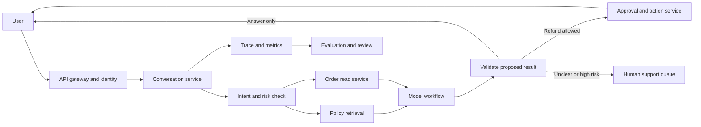

# 38 — Deep Dive: Production Support Agent

This walkthrough shows how to take one customer problem from discovery to a
production decision. The architecture is less important than the reasoning
that produces it.

## Problem

A large online marketplace wants an AI assistant to answer support questions,
look up orders, and handle simple refunds. It should reduce support work
without making promises that policy does not allow or moving money
incorrectly.

## Start by narrowing the outcome

Do not accept "replace support agents" as the goal.

Ask:

- Which request types create the most volume or handling time?
- How are correct outcomes recorded today?
- Which actions can be reversed?
- What refund amount can be approved automatically?
- Which users, regions, and languages are in the first launch?
- Which policy source is authoritative?
- What is the current resolution rate, handling time, and cost?
- What requires a person today because of law, policy, or judgment?

Assume the first version covers:

- order status;
- return-policy questions;
- refunds below a fixed limit when a deterministic policy check approves;
- human handoff for disputes, account security, missing evidence, or larger
  amounts.

It does not change account identity, payment methods, or shipping addresses.

## Define success and release blockers

Example goals:

| Measure | Goal |
|---|---|
| Correct resolution or handoff | Better than the current workflow |
| Incorrect money movement | Zero in the release evaluation |
| Policy-supported answers | At least the agreed quality bar |
| Human handling time | Lower for covered request types |
| p95 time to first response, meaning 95% are faster | Inside the product target |
| Cost per resolved conversation | Below the current support cost |

Release-blocking failures:

- refund issued for the wrong account or order;
- amount exceeds policy or approval limit;
- assistant invents a policy or promise;
- private order data shown to the wrong user;
- unsafe tool action caused by text in retrieved data;
- no human handoff when required.

An average score cannot hide one of these.

## Estimate the workload

Use illustrative numbers until the customer provides real ones:

- 200,000 conversations per day;
- 6 model turns per conversation;
- 3,000 input tokens and 250 output tokens per turn;
- peak traffic is five times the daily average.

```text
model turns per day = 200,000 × 6 = 1,200,000
average turns/s     = 1,200,000 / 86,400 ≈ 14
peak turns/s        = 14 × 5 ≈ 70
peak tokens/min     = 70 × 3,250 × 60 ≈ 13.7 million
```

This is a first capacity estimate. Tool calls, retries, longer conversations,
and traffic spikes add headroom. Check provider rate limits and load-test the
complete path before launch.

## Start with a fixed workflow

The request path is mostly known. A free-running agent is unnecessary.



The model handles language and uncertain interpretation. Code handles identity,
permissions, money limits, and audit. A unique request ID prevents a retried
write from moving money twice.

## Walk one request

User request:

> "The headphones arrived broken. Can I get my money back?"

### 1. Authenticate before model work

The gateway verifies the user and passes an internal customer ID. The prompt
does not ask the model to decide who the user is.

### 2. Classify intent and risk

The system identifies a damaged-item refund. A rule marks refunds as an action
path. Account-security phrases or unusually high amounts go directly to a
person.

### 3. Load independent facts in parallel

Fetch:

- the order and item status;
- the current refund policy for the user's region;
- earlier refunds or case state needed by policy.

Policy retrieval returns the policy version and source text. Order notes and
customer messages are untrusted data, not instructions.

### 4. Ask the model for a typed proposal

The model receives only the needed facts and returns:

```json
{
  "decision": "refund",
  "order_id": "ord_123",
  "item_id": "item_7",
  "amount_cents": 8900,
  "policy_id": "returns_us_v12",
  "reason": "Item reported damaged within the return window",
  "needs_human": false
}
```

Structured output makes the result parseable. It does not prove the decision
is correct.

### 5. Validate outside the model

Code checks:

- order belongs to the authenticated user;
- item and amount match the order system;
- policy version is current;
- deterministic eligibility rules pass;
- amount is below the automatic limit;
- request has not already produced a refund.

If any check fails, no action occurs.

### 6. Execute with an idempotency key

Use a key such as:

```text
refund:{conversation_id}:{order_id}:{item_id}
```

A retry with the same key returns the original result instead of issuing a
second refund.

### 7. Answer from the recorded result

The assistant explains what happened and cites the relevant policy in user
language. It never claims success until the action service reports success.

### 8. Store a safe trace

Record:

- request and trace IDs;
- prompt, workflow, policy, and model versions;
- tool names, timings, and status;
- proposed and validated decisions;
- approval and idempotency result;
- tokens, latency, and cost;
- final outcome and later human correction.

Redact or restrict sensitive content according to the data policy.

## Tool design

Keep read and write capabilities separate.

```text
get_order(customer_id, order_id)
get_return_policy(region, purchase_date, item_type)
check_refund_eligibility(order, policy, reason)
issue_refund(order_id, item_id, amount_cents, idempotency_key)
create_support_handoff(conversation_id, reason, summary)
```

The model may propose `issue_refund`, but the application controls whether the
tool is available and whether approval is required.

Tool results should be compact:

```json
{
  "status": "approved",
  "refund_id": "ref_456",
  "amount_cents": 8900
}
```

Do not return a large internal order record when five fields are enough.

## State and ownership

| State | System of record |
|---|---|
| User identity and account permissions | Identity service |
| Order and payment state | Commerce services |
| Current policy | Versioned policy store |
| Conversation state | Conversation service |
| Refund decision and approval | Action service |
| Model trace and quality labels | Observability and evaluation stores |

The model provider is not the system of record for money or identity.

## Build the evaluation

Start with 300-500 past or synthetic conversations. Remove sensitive data and
preserve the decision-relevant structure.

Include:

| Slice | Example |
|---|---|
| Normal lookup | "Where is my order?" |
| Eligible refund | Damaged item inside the allowed window |
| Ineligible refund | Item outside the window |
| Ambiguous | User mentions two orders |
| Missing data | Order service has no matching item |
| Duplicate | User repeats a request after a timeout |
| Policy conflict | Old article disagrees with the current policy |
| Injection attempt | Order note says to ignore system rules |
| Authorization | User asks about another person's order |
| High risk | Account takeover, threat, or large amount |

Grade each layer:

1. Correct intent and risk class.
2. Correct policy and order retrieved.
3. Correct tool chosen.
4. Correct arguments.
5. Correct validation and approval.
6. Correct final answer or handoff.
7. Latency, tokens, turns, and cost.

Use exact checks for IDs, amounts, tool calls, and action outcomes. Use a
written rubric for clarity and policy support. Calibrate the model grader
against people who understand the policy.

## Model and architecture experiments

Baseline the strongest practical model first. Then compare:

- smaller model for intent and low-risk lookup;
- stronger model only for ambiguous cases;
- one call versus separate classify and answer calls;
- full policy context versus retrieval;
- fixed workflow versus a tool-choosing loop;
- different reasoning effort;
- repeated static prefix with prompt caching;
- sequential versus parallel read tools.

Keep the cheapest design that clears every release bar. Optimize under the
quality constraint, not instead of it.

## Latency budget

An example target:

| Step | p95 budget |
|---|---:|
| Gateway and identity | 100 ms |
| Order and policy reads in parallel | 400 ms |
| First model response | 1,000 ms |
| Validation and action | 500 ms |
| First user-visible text | 1,500 ms |
| Full simple request | 3,000 ms |

Measure real distributions. One slow dependency or repeated model turn can
consume the whole budget.

## Cost model

```text
cost per resolved conversation =
  model calls
  + retrieval and tool infrastructure
  + retries and failed runs
  + human-review time
  + cost of incorrect actions
```

Report:

- cost per conversation;
- cost per correctly resolved conversation;
- cost per request type;
- human minutes saved;
- cost and quality for each tested model configuration.

The last two often matter more than token price.

## Failure design

| Failure | Response |
|---|---|
| Model timeout | Retry inside a deadline, then hand off |
| Provider rate limit | Back off with jitter and protect the human path |
| Order service unavailable | Do not guess; offer status update or handoff |
| Policy retrieval empty | Block action and hand off |
| Invalid model output | Reject before tool execution |
| Refund call times out | Query by idempotency key before retrying |
| Prompt injection in tool data | Keep tool data untrusted; enforce capability limits |
| Trace store unavailable | Continue only if the money action remains auditable |
| Quality regression | Stop rollout and restore the last accepted version |

## Rollout

### Stage 1: offline

Replay the evaluation set and historical cases. No live users.

### Stage 2: shadow

Run on live traffic. Human agents cannot see or use the result yet. Compare
the proposed action with the actual support outcome.

### Stage 3: draft

Show recommendations to support agents. Every answer and action requires
review. Measure acceptance, edits, handling time, and missed escalations.

### Stage 4: limited automation

Allow automatic answers for order status and policy questions. Keep money
actions reviewed.

### Stage 5: bounded action

Allow refunds only for cases that pass deterministic checks and stay below the
approved limit. Expand by request type, not all at once.

Each stage has a stop metric, owner, and rollback path.

## What the customer receives

- working reference implementation;
- architecture and threat model;
- evaluation dataset and runner;
- result table across model configurations;
- dashboards and alerts;
- runbook and rollback steps;
- known limits and unsupported cases;
- production backlog with owners;
- a short decision document: launch, iterate, or stop.

## How to present the design

Lead with:

> "I would narrow the first release to request types with a clear policy and a
> reversible outcome. The model can interpret language and propose an action,
> but identity, policy limits, idempotency, and money movement stay in code."

Then cover:

1. Business metric and highest-cost failure.
2. Fixed workflow before an open agent loop.
3. Typed tools and deterministic validation.
4. Evaluation by request type and action safety.
5. Rough scale, latency, and cost.
6. Shadow, draft, then bounded automation.

If time remains, go deep on idempotency, prompt injection through tool data,
or how the eval becomes a release gate.

This presentation shape works in a customer review or architecture meeting.
It can also help with a technical job interview when needed.

## Go deeper

- [Official OpenAI Responses API guidance](https://developers.openai.com/api/docs/guides/migrate-to-responses)
- [Official OpenAI function-calling guidance](https://developers.openai.com/api/docs/guides/function-calling)
- [Official OpenAI evaluation best practices](https://developers.openai.com/api/docs/guides/evaluation-best-practices)
- [Tool-Using Agent workshop](../05-workshops/W4-tool-using-agent.md)
- [Real Evaluation workshop](../05-workshops/W3-real-evaluation.md)
- [Security and Safety](../01-foundations/05-security-and-safety.md)
